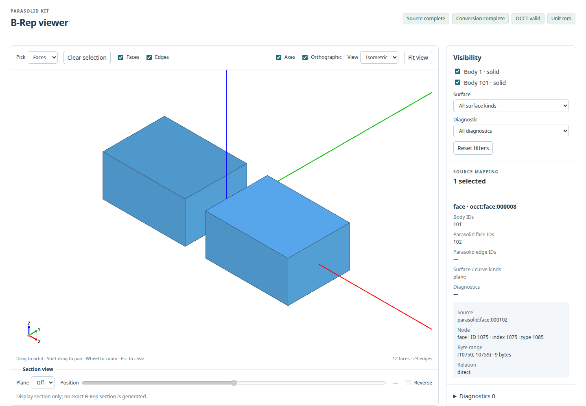

# parasolid-kit

A schema-aware parser for Parasolid X_T and X_B transmit files. A safe Rust
core handles parsing and geometry mapping; Python exposes immutable typed
models and a command-line interface. The project focuses on reading and
preserving the transmitted structure for inspection and conversion pipelines.

Rust applications can use [parasolid-core](crates/parasolid-core/README.md)
directly, without Python.

## Features

- Inspect headers and map supported topology, analytic geometry and NURBS to
  a typed source B-Rep.
- Compare X_T/X_B documents after pointer remapping and reconstruct an
  unmodified parsed X_B document byte-for-byte.
- Report structured diagnostics and enforce configurable resource limits.
- Evaluate supported source curves/surfaces and sample curves without OCCT;
  resolve nested assembly placements without changing the source model.
- Decode stored polylines and embedded mesh pools with an explicit named
  schema catalog, and view those selected records without OCCT.
- Use optional OCCT conversion, validated STEP export, CadQuery shapes and a
  local viewer with face/edge source picking, body visibility and section views.

## Installation

Python 3.10+ is required. The base package has no runtime dependencies:

```bash
python -m pip install parasolid-kit
```

For STEP export and the viewer, install the OCCT profile:

```bash
python -m pip install "parasolid-kit[occt]"
```

See [installation](docs/installation.md) for platform requirements, the separate
CadQuery profile, downloaded wheels and source builds.

## Quick start

For an input covered by a built-in profile:

```bash
parasolid-kit inspect model.x_b          # Header only; no schema catalog needed.
parasolid-kit check model.x_b            # Parse and check the source B-Rep.
parasolid-kit check model.x_t --json     # Structured report.
parasolid-kit compare model.x_t model.x_b
```

See [geometry operations](docs/api.md#dependency-free-geometry-operations) for
evaluation, assembly occurrences, and stored geometry examples. The viewer
accepts `--assembly` to display repeated/nested body placements and
`--stored-geometry --schema-dir schemas` for selected stored mesh/polyline data.

The same workflow is available in Python:

```python
from parasolid_kit import read_brep

parsed = read_brep("model.x_b")
print(parsed.summary.to_dict())
print(parsed.complete)
print(parsed.brep.diagnostics)
```

`complete` describes source B-Rep mapping. Geometry conversion and a native CAD
file's saved configuration have separate requirements. Use `check` when
completeness must affect the CLI exit code. See the [Python API](docs/api.md)
and [CLI reference](docs/api.md#cli) for lower-level operations and diagnostics.

## Local viewer

To try the viewer from a source checkout with Rust 1.88+ installed:

```bash
python -m pip install ".[occt]"
parasolid-kit viewer model.x_t --source-unit mm
```

Choose the input's actual unit; it is never inferred. `view` is an alias.
The command opens a local URL; Ctrl-C stops serving and keeps the generated
files. Node.js and a CDN are unnecessary at runtime.



Project-authored synthetic two-body fixture, rendered with Linux/SwiftShader.
See [preview controls and saving](docs/api.md#bounded-local-preview),
[display limits](docs/format-support.md#viewer-display-boundary) and
[viewer development](viewer/README.md).

## Supported inputs

Built-in profiles cover exact Onshape V30/V13/current, extracted iCAD and
SolidWorks partition keys, five observed TopSolid v6 X_T keys, five transmit-file
keys (NX and the Parasolid 24 and 26 acceptance tests), and six standard keys
of Parasolid 9 to 16 (NX, MicroStation, IronCAD, SolidWorks). These profiles
have `verified_subset` coverage; application user fields are read. The TopSolid
profiles use bundled base and effective catalogs for the five listed keys,
not general TopSolid package or model decoding. Other exact profiles are
completed by their schema family. A key with no exact profile is read with the
[schema family](docs/format-support.md#schema-families) of its effective
schema and base (another Parasolid build of a reviewed schema) and reports
`family_inferred` coverage; its node types must still be covered by the
family's merged declarations. Consult the
[support matrix](docs/format-support.md#supported-profiles)
for exact keys, families and geometry limits; matching a key does not
guarantee that all records are supported. Other schemas or uncovered types need
an explicit [schema catalog](docs/schema-catalogs.md).

Native CAD containers and SolidWorks delta application are outside the
complete parser contract. Assembly structure (instances and their transforms)
is returned beside the B-Rep; source geometry remains unplaced. OCCT conversion
and the viewer can explicitly request instance placement.
Parsing, OCCT conversion, STEP export and preview have separate coverage. See
[format support and limitations](docs/format-support.md).

## Documentation

| Topic | Guide |
|---|---|
| Setup and optional runtimes | [Installation](docs/installation.md) |
| Python models, conversion and CLI | [API reference](docs/api.md) |
| External schema providers | [Schema catalogs](docs/schema-catalogs.md) |
| Supported inputs and geometry | [Support matrix](docs/format-support.md) |
| Profile sources and validation | [Built-in profiles](docs/builtin-profiles.md) |
| Release changes | [Changelog](CHANGELOG.md) |
| Maintainer verification | [Release gates](docs/releasing.md), [corpus policy](corpus/README.md) |

## License

The distribution is licensed under `MIT AND Apache-2.0`: the original
implementation uses [MIT](LICENSE), and adopted partial readers use
[Apache-2.0](LICENSES/Apache-2.0.txt). See [reader provenance](crates/parasolid-core/PARTIAL_READERS.md)
and [viewer notices](viewer/README.md#dependencies-and-licenses).
